<a href="README.md"><picture><source media="(prefers-color-scheme: dark)" srcset="docs/brand/logo-on-dark.svg"></picture></a>

# Features

Everything driftless sets up, in one page. `SUPER + SHIFT + K` lists every key on the running desktop,
searchable as you type.

## Keys you'll use every day

| Keys | What |
|---|---|
| `SUPER + SPACE` | App launcher: apps, calculator, web search |
| `SUPER + RETURN` / `SUPER + SHIFT + RETURN` | Terminal / browser |
| `SUPER + D` | Dictation into the active window (tap: start/stop, hold: push-to-talk) |
| `SUPER + A` | Ask Claude by voice: the answer appears at the top and is spoken (tap or hold, like dictation) |
| `SUPER + C` | Clipboard history |
| `SUPER + .` | Emoji picker |
| `SUPER + SHIFT + S` · `SUPER + SHIFT + A` | Screenshot of an area · the same, to annotate |
| `SUPER + K` | Colour picker (hex code to the clipboard) |
| `SUPER + SHIFT + P` | Display mode: extend, mirror, one screen (like Win + P) |
| `SUPER + L` | Lock the screen |
| `SUPER + SHIFT + M` | Power menu: lock, log out, suspend, reboot, shut down |
| `SUPER + N` · `SUPER + SHIFT + N` | The notifications · do not disturb on/off |
| `SUPER + SHIFT + K` | Every keybinding, searchable |

<table>
<tr>
<td width="50%">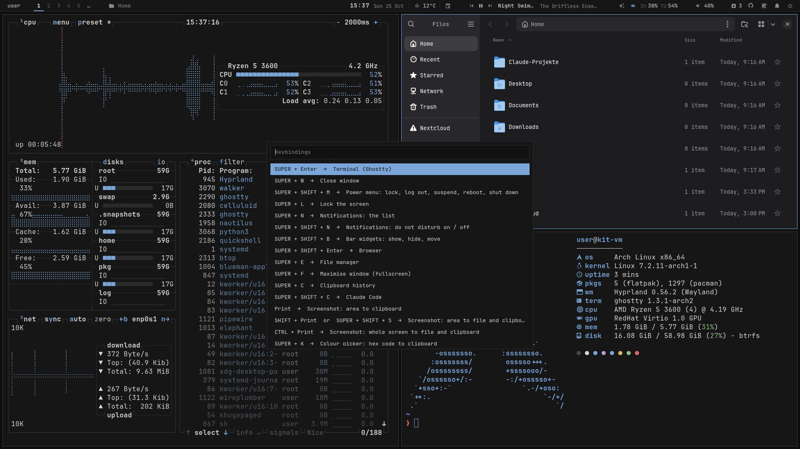 <code>SUPER + SHIFT + K</code>: every key of the running desktop.</td>
<td width="50%">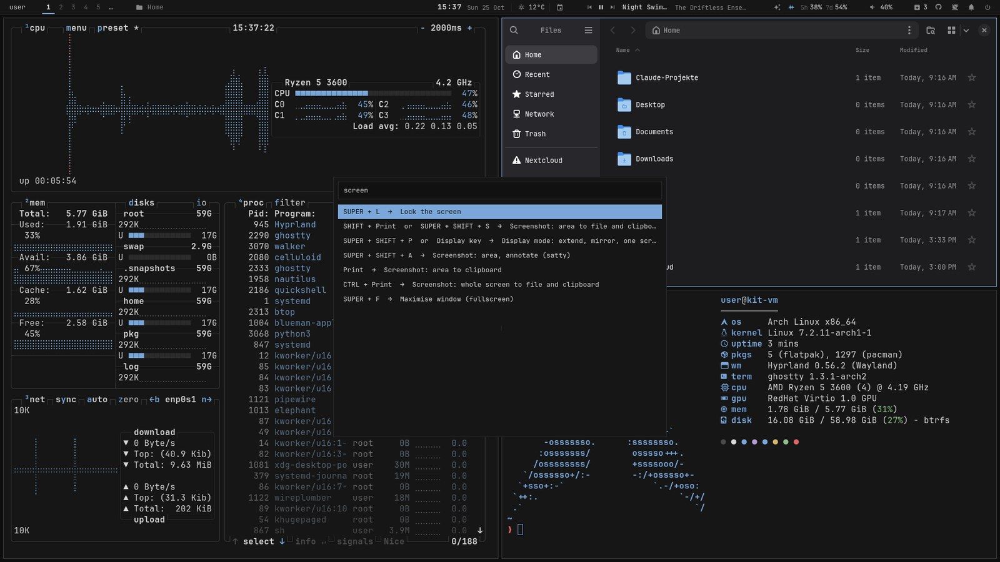 Type to filter: <code>screen</code> leaves the screenshot, display and fullscreen keys.</td>
</tr>
</table>

## Dictation

Speak, and the text lands in whatever window is active, terminals included. All of it runs locally on
the GPU (Vulkan: AMD, Intel and NVIDIA):

- **whisper.cpp** (large-v3-turbo) transcribes, a voice detector keeps it from inventing text in silence
- **a small LLM** (`gemma3:4b` via Ollama) tidies up: fillers out, punctuation in, "Tuesday, no, I
  mean Wednesday" becomes "Wednesday". Spoken "comma", "new line", "new paragraph" work too
- about 1-2 seconds from letting go to the text; `SUPER + SHIFT + D` skips the LLM
- the model leaves VRAM after 5 minutes, so games get it back
- language, models and names Whisper should know: `DICTATE_*` in `personal/config`

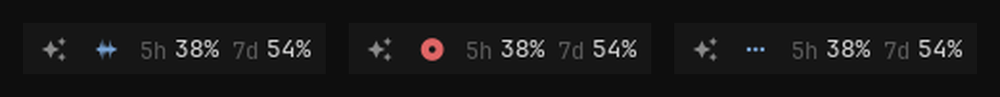 
The dictation icon in the bar: ready, recording, transcribing. Click: start/stop, right click: without the LLM, middle: cancel.

## Asking Claude

`SUPER + A`, a question, and the answer appears in a bubble at the top of the screen while a voice
reads it out. Like Siri or Alexa, for the quick things, without opening a window:

<table>
<tr>
<td width="50%">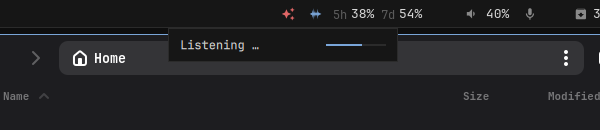 Listening: the line follows your voice.</td>
<td width="50%">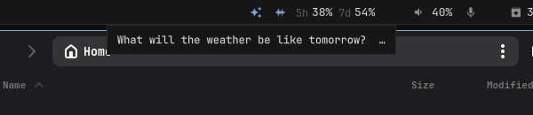 Your question while Claude works on it.</td>
</tr>
<tr>
<td width="50%">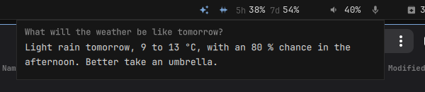 The answer, read out at the same time.</td>
<td width="50%">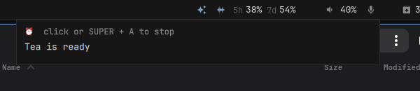 A timer rings until you stop it.</td>
</tr>
</table>

| Say | What happens |
|---|---|
| "Set a timer for 10 minutes for the pasta", "Remind me at 3 to call Anna" | a gentle marimba alarm that swells until a click or `SUPER + A` stops it, and the voice says what it was for; "Which timers are running?", "Cancel the timer" |
| "Do I have anything on this afternoon?", "Put the dentist in for Tuesday at 3" | reads and adds calendar events (khal, synced right away) |
| "What will the weather be like tomorrow?" | now and three days, for your `WTTR_LOCATION` or any place |
| "What's on my screen?", "Summarise this article", "What does this error mean?" | Claude looks at a screenshot of your monitor |
| "Translate what I copied", "Write a polite reply that I'm ill and paste it" | reads the clipboard, types text into the active window |
| "Note: buy milk", "What did I note?" | a notes file (`NOTCH_NOTES`, default `~/Documents/notes.md`) |
| "Pause the music", "Next song", "Volume to 30", "Brighter" | media, volume, screen brightness |
| "How full is the battery?", "Are there updates?", "Connect my headphones" | battery, disk, memory, network, pending updates, Bluetooth |
| "Do not disturb", "Lock the screen", "Suspend" | |
| "Open Firefox", "Find my tax return", "Open the Arch Wiki on PipeWire" | starts apps, finds files by name, opens files and pages |
| "What's 18 % of 240?", "How do you say thank you in Japanese?", news, facts | answered directly or from a web search |

A question within two minutes continues the conversation ("And on Friday?"). A click on the bubble or
a new question stops everything.

Whisper transcribes locally (the dictation setup), Claude Code answers (`claude -p`, Haiku by default)
and may use only `notch/tools.py` (the actions above), the screenshot and web search, without asking
and without your Claude Code settings. Piper speaks the answer sentence by sentence as it arrives,
locally too (installed into a venv on first use). The bubble is part of the desktop shell, a plain box
below the bar: "Listening …" with the microphone's level, your question while Claude thinks, then the
answer. Model, language, voice and notes file:
`NOTCH_*` in `personal/config`.

It searches the web but does not fetch pages itself: a page or your screen can carry instructions, and
a fetch would give them a way to send out what the assistant has seen in the address it asks for.
`NOTCH_WEBFETCH=on` allows it. "Open ..." starts web addresses, files and folders, never programs
or launchers.

## The bar

One bar per monitor, drawn by Quickshell together with its popups and the Claude bubble: compact on
notebook panels, spacious everywhere else: one flat strip along the top edge with a line below it,
values as text, icons in one grey. It follows the look (dark or light) and your widget layout live,
without a restart. Groups from left to right:

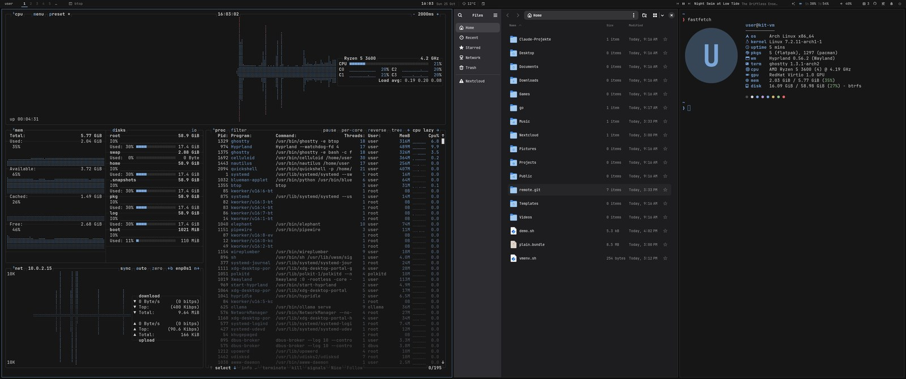 
The spacious bar on a 3440x1440 ultrawide.

- **You**: your name; click: about this machine (model, processor, system, kernel, Hyprland,
  Quickshell and driftless versions, uptime, the last full upgrade, memory and disk; your picture,
  lock, log out)
- **Workspaces** (the active one bright, with a line in the accent below it) and the **active window**
- **Clock with your next calendar event, and the weather**. Next to the date: the next event within
  two days behind an accent dot (amber when the calendar sync failed); hover for the agenda. Click the
  clock: the month with a dot on every day that has events, click a day for its events, and what comes
  up; right click: ikhal. Click the weather: the next hours and three days
- **Media**: play/pause, skip, the title (cut with "…" when it is long). Click it: cover, progress (click
  to jump), shuffle and repeat, and every player that runs
- **Tray**, folded away: an arrow opens all the apps' own icons in a small box (click: the app; right
  click: its menu in the same style, below the icons, which stay usable). The pin on an icon keeps it in the bar next to the arrow (per
  machine); the arrow lights up while a folded app asks for attention
- **Privacy indicator**, right after the tray and only while it matters: an amber box with a symbol
  for each of microphone, camera and screen while an app records, films or shares it (red while the
  screen is shared). Hover: which apps; click: mute the microphone, wheel: its level. Sees PipeWire
  streams, programs that open the camera directly and screen recorders that copy straight from Hyprland
- **Voice and Claude**: the ✨ button asks Claude by voice (click: talk, click again: send; the bubble
  opens below it), dictation next to it, then Claude's session and weekly limits; click them: both
  with their resets and the tokens per day
- **Status**: network (click: Wi-Fi networks, join a known one, on/off), Bluetooth (click: your devices
  with their battery, and the ones nearby to pair with one click; right: on/off), volume (wheel: level;
  click: outputs, microphones and a level per app that plays; right: mute), battery (click: time left,
  power draw, health, power profile)
- **Session**, always at the edge: updates while some wait (click: update in a terminal), the sync
  (the driftless mark in the colour of its state; click: its menu), notifications (click: the list;
  right: do not disturb; middle: clear all), keep awake, the settings (cog), power (click: the power
  menu; right: lock)

Hover anything for a tooltip; a click elsewhere or `Esc` closes a popup. Popups also open from a key
binding or a script: `quickshell ipc -p ~/.config/quickshell call bar popup calendar` (`weather`,
`media`, `claude`, `audio`, `network`, `bluetooth`, `battery`, `notifications`, `settings`, `sync`,
`tray`, `about`). They are built alike: a first line with the sign, the name and how it stands, the
controls on the right, "…" on a button that opens something else.

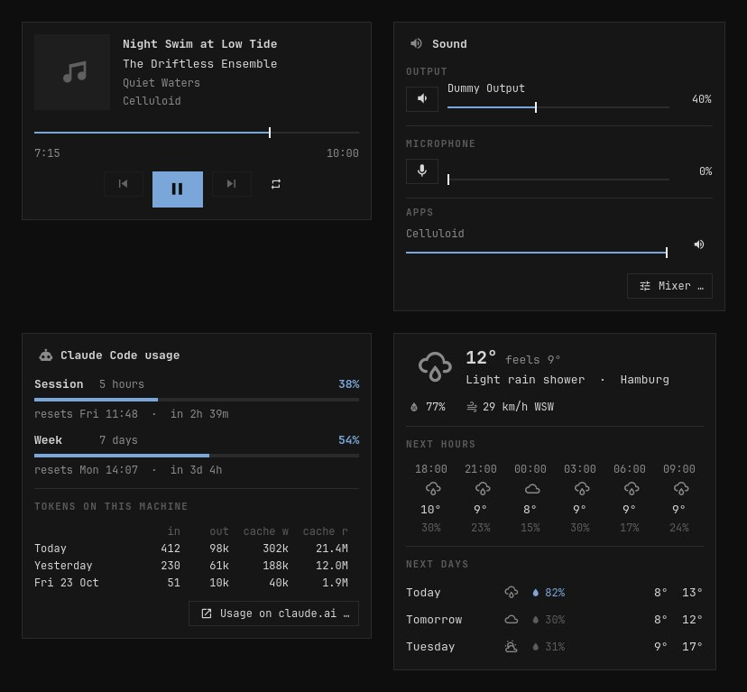 
Popups: what plays, sound with a level per app, Claude usage, the weather.

## Notifications, login and lock screen, power menu and password dialog

The same shell draws everything around the bar, in the same plain boxes and colours, so nothing on
the desktop looks borrowed from another program.

- **Notifications** pop up at the top right of the screen you work on, below the bar: the app's icon
  or the picture it sent, the text, a progress bar when it sends one, its buttons, and a thin line
  that runs out (it waits while the pointer is on the card). Click: the app's action or its window ·
  right click, `×` or a swipe: away. A notification that replaces another one (a download, the
  calendar sync) updates the card in place
- **The list** (the bell, `SUPER + N`): everything still there, grouped by app, with **do not disturb**
  (`SUPER + SHIFT + N`, or a right click on the bell: only critical ones pop up) and "clear". The bell
  glows while there is something you have not seen. The list outlives a restart and a new login (seven
  days, in `~/.local/state/driftless-shell` on this machine only, readable only by you); kept ones come
  back without their buttons
- **Quiet in fullscreen**: while the workspace you look at has a fullscreen window (a game, a video),
  only critical notifications pop up; afterwards one card says how many came in meanwhile (click: the
  list)
- **On-screen display**: volume, mute, the microphone, a new output device (headphones plugged in) and
  the brightness keys show a small box at the bottom, from the keys, the bar or anywhere else
- **Lock screen** (`SUPER + L`, after 10 minutes, before sleep): the login screen's look, so locking
  and logging in feel like one thing: one dark colour, the clock, the date, your name and the password.
  It only counts what came in meanwhile, the cards come when you are back. hyprlock stays as the
  fallback when the shell does not answer, and a shell that crashes while locked takes the lock over
  again after its restart: the screen never opens by itself
- **Login screen**: the lock screen's column on the same dark colour, with the machine, the session (a
  click picks another one, when there is more than one) and reboot and shut down below. It runs as
  greetd's own user and shows only what `set-wallpaper` hands it: the colours and your name. If it
  ever fails to start, ReGreet takes over
- **Screensaver** (`driftless-saver`): before the lock, a lattice of grey points fills the screen and
  runs out in slow streams, while a sync that is not drawn crosses it again and again and every loose
  point it reaches glides home in the accent. Without end, in the look's colours (it follows dark,
  light and the palette); any input ends it. `driftless-saver` alone runs it in the terminal you are in
- **Power menu** (`SUPER + SHIFT + M`, the power button): lock, log out, suspend, reboot, shut down
  as a list in the middle of the screen, with the arrows and Enter or the letter of a row. Suspend locks first
- **Password dialog**: when a program asks for more rights (driftless installing packages, a mount, an
  app's settings), a plain box asks for your password in the middle of the screen, with what is
  asked and the polkit action it is for. The shell is the session's polkit agent. Note: polkit counts a
  cancelled request like a wrong password, and three in a row lock `sudo` and polkit for ten minutes
  (Arch's `pam_faillock`)
- **New packages are explained first**: when your lists name packages this machine lacks, a
  notification and the sync icon (with the count) offer a review, a popup at the icon that never
  takes the screen (right away after *Sync now*): each package with its description, size
  and the machine and commit that listed it, the dependencies that come along, the download, and why
  the next step asks for the password. *Install*, or × to leave one out on this machine only. The
  password dialog then names the packages instead of a command line, and a notification says what
  was installed

<table>
<tr>
<td width="50%">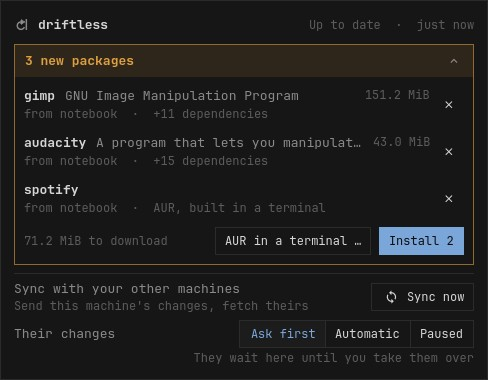 New packages in the sync icon's popup: what waits stands out in its frame.</td>
<td width="50%">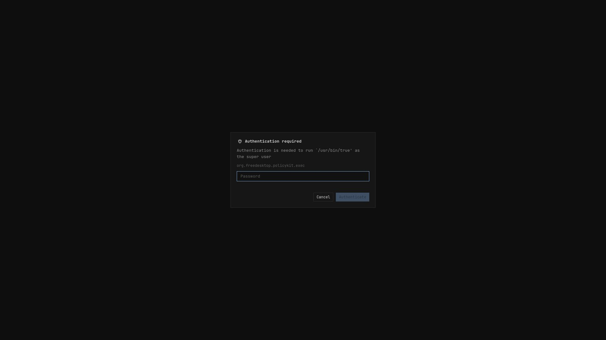 Their <i>Install</i>: the password dialog names the packages.</td>
</tr>
</table>

<table>
<tr>
<td width="50%">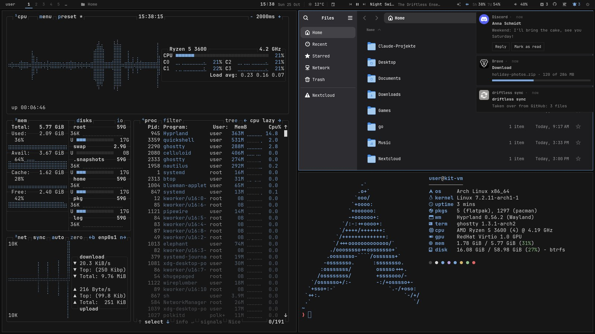 Notifications below the bar.</td>
<td width="50%">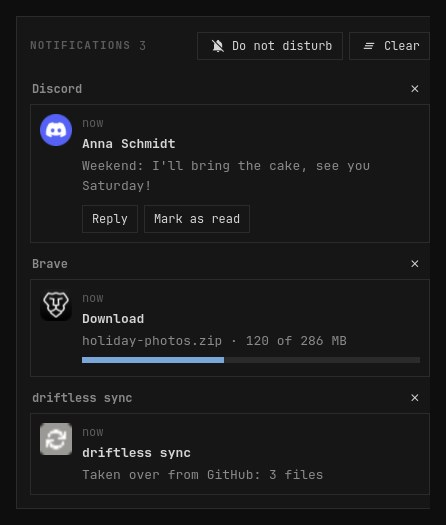 The bell's list, grouped by app.</td>
</tr>
<tr>
<td>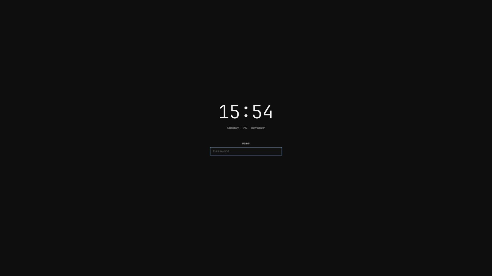 The lock screen.</td>
<td>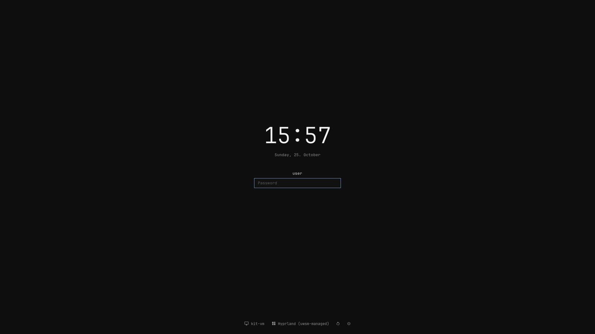 The login screen.</td>
</tr>
</table>

<table>
<tr>
<td width="50%">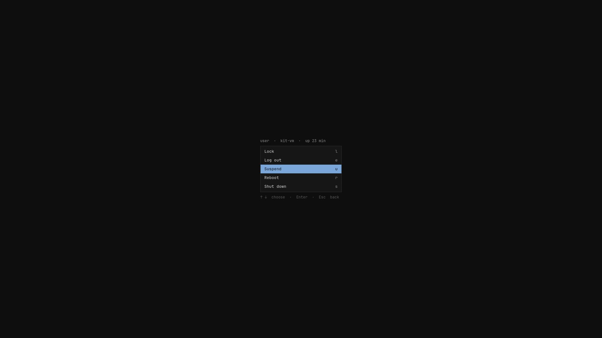 The power menu.</td>
<td width="50%" align="center">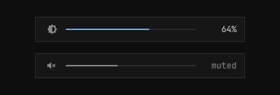 The on-screen display.</td>
</tr>
</table>

## Settings menu

A click on the cog at the right edge opens them as a popup of the bar, laid out like a settings app: the pages on the
left (Appearance, Bar, Displays, Notifications, Mouse & keyboard, Power, System), on the right one row
per setting with its switch or button.
Every choice is per machine (but your picture):

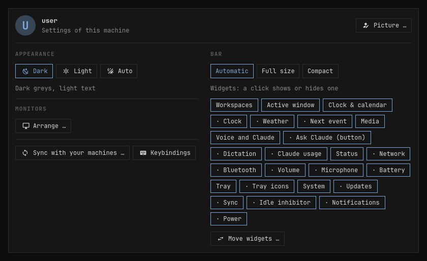 
The settings popup.

- **Your picture**: a click on it (or "Change …" under Appearance) picks an image, then you place it
  behind a round mask: drag to move, wheel or slider to zoom. The settings, fastfetch and the notifications use it.
  It is `~/.face`; linked into `personal/` (as `examples/personal/manifest` suggests), the sync takes it
  to your other machines, which render it too
- **Appearance**: dark, light, or auto (light from sunrise to sunset), and the palette (plain, Catppuccin,
  Dracula, ...: a grid of tiles, each shows a few of its colours); a click switches everything at once
- **Bar size**: automatic, always full size, always compact
- **Clock**: 24 or 12 hours, seconds, the date next to the time
- **Widgets**: a switch per widget, the bar follows at once (a group that is off takes its members
  with it); "Arrange …" orders them,
  separately for the spacious and the compact bar
- **Monitors**: arrange them (nwg-displays), the display mode on a notebook, back to the automatic layout
- **Night light**: warmer colours from sunset to sunrise (today's times from the weather) or always,
  four warmths; hyprsunset runs only while it is on (`services/NightLight.qml`)
- **Notifications**: do not disturb, whether a fullscreen window (a game, a video) holds them back,
  clearing the list
- **Mouse & keyboard**: pointer speed, focus follows the mouse; on a notebook natural scrolling, tap to
  click, the touchpad off while typing; how soon and how fast a held key repeats; the searchable list of
  keybindings. Hyprland follows at once (`hyprctl eval`), the choices stay in
  `~/.local/state/hypr/input.lua`, loaded after the host and personal layers
- **Power**: the screensaver after 1, 3, 5, 10 minutes or never, lock the screen and turn it off after
  5, 10, 15, 30 minutes or never (hypridle reads the times from `~/.local/state/hypr/idle.conf`), keep awake, the power profile on a notebook, the power menu
- **Sync**: *Sync now*, what happens with the other machines' changes (ask first, automatic,
  paused), whether new packages are offered here; "Show …" opens the sync icon's popup
- **About**: a button that opens the card about this machine (the same as a click on your name)

The choices beyond the look and the bar are `scripts/prefs.py`'s (`~/.local/state/driftless-shell/settings.json`,
only what you changed).

## The plain look

One look for the whole desktop, reduced to what is needed: neutral greys and one accent (blue), a
desktop of one colour, everything opaque, square and framed by a 1 px line, one font
(JetBrainsMono Nerd Font) in two sizes. No blur, shadows, gradients, rounded corners or animations,
in the shell nor in Hyprland (windows: a 1 px border, the one with focus in the accent, small gaps).
The accent marks only what is active, selected or focused; orange and red only what needs attention.

`theme/apply.py` renders it into the shell (bar, notifications, login and lock screen, power menu),
walker, Ghostty, GTK, Qt, btop, starship and VS Code (theme "driftless": 2026 Dark or Light with the
accent). The calendar, fastfetch, bat and fzf use the terminal's accent slots, so they follow too.

- **Dark or light**, or auto (light from sunrise to sunset, the weather feed's times), per machine in
  the settings. GTK, libadwaita, Electron apps, Qt, Ghostty, walker, btop, starship, VS Code and
  Hyprland follow; the lock and the login screen stay dark, as one night screen
- **Softer palettes** in place of the plain greys, each dark and light so auto works with all of them:
  Catppuccin (Mocha, Latte), Dracula (Dracula, Alucard), Everforest, Gruvbox, Nord (Polar Night, Snow
  Storm), Rosé Pine (Rosé Pine, Dawn), Solarized and Tokyo Night (Night, Day). They keep the plain look's
  form (opaque, square, one accent) and bring their own background, text, accent and terminal colours,
  in the originals' contrast. Per machine in the settings, or `theme/apply.py --palette NAME`
- `set-wallpaper --current` renders it all again (it keeps its name from the days of wallpaper images)

<table>
<tr>
<td width="50%">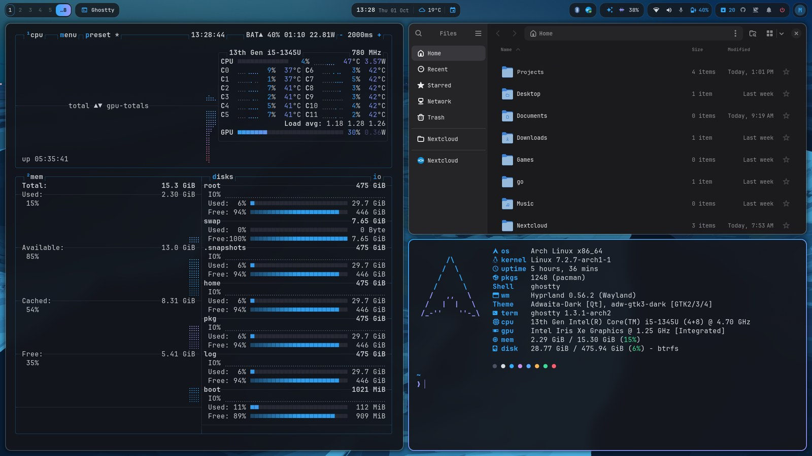 Dark.</td>
<td width="50%">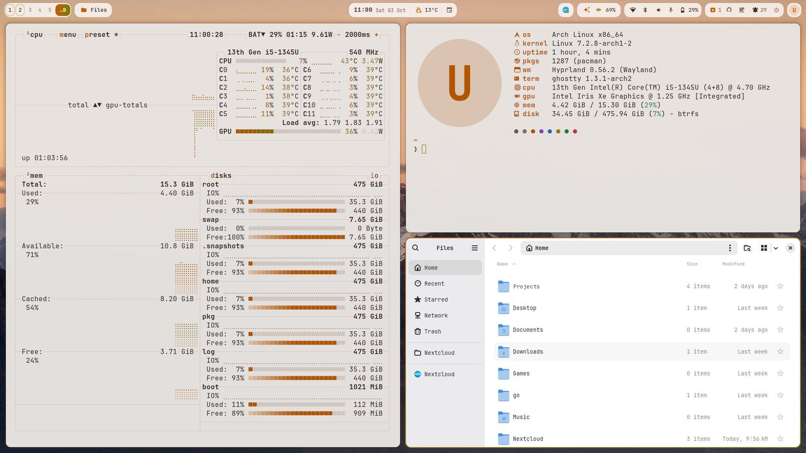 Light.</td>
</tr>
</table>

## Gaming

Steam, Proton-GE, Lutris, gamescope and gamemode, with tearing allowed for games (lower input
latency) and rules that open stubborn games fullscreen on the right monitor.

## The system underneath

- **btrfs with snapper** snapshots, optional **LUKS2** encryption (TPM unlock: [docs/encryption.md](docs/encryption.md))
- **unified kernel images**, with an LTS kernel as fallback ([docs/boot.md](docs/boot.md))
- zram, a firewall (ufw), SMART warnings as desktop notifications, locked screen after 10 minutes
- **printing** without drivers: CUPS finds network printers that speak IPP Everywhere or AirPrint
  (most from the last ten years) and offers them in every print dialog; `system-config-printer`
  sets one up for good
- **SSH** on every machine, with keys only (no password, no root login) and a rate limit in the
  firewall. The keys that may log in stay in each machine's `~/.ssh/authorized_keys`
- an **SSH agent** in every session: give your key a passphrase, and with `AddKeysToAgent yes` in
  `~/.ssh/config` you type it once per session
- the session runs under uwsm: the shell (bar, notifications, lock screen), idle, clipboard and
  the desktop colour are systemd user units that restart when they crash

## Keeping your machines in step

- your home is **links into the repository**: editing `~/.config/hypr/hyprland.lua` is editing the
  repository
- an **hourly sync** commits what you changed and takes over what your other machines changed, but only
  commits one of your machines signed; it refuses anything that looks like a password
- **package lists** you write (`driftless packages add NAME GROUP`), picked per machine by its hardware:
  repo, AUR and Flathub apps (`flatpak:APP_ID`, no password needed), offered with a review before
  anything is installed; the update pill counts and
  installs flatpak updates too
- what differs per machine goes into `hosts/<host>/`, what is yours into `personal/`
- `driftless verify` shows where a machine differs from the repository; a new machine is two scripts
  away ([README](README.md#install-a-new-machine))
